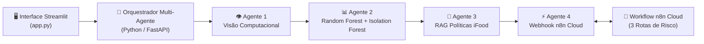

# 🍔 iFood Sentinel & MenuOps AI Engine

[](https://www.python.org/)
[](https://streamlit.io/)
[](https://fastapi.tiangolo.com/)
[](https://scikit-learn.org/)
[](https://n8n.io/)

> **Central Inteligente Multi-Agente (GenAI + Machine Learning Clássico + RAG + Automação n8n via MCP)** construída para o Portfólio do **Programa de Estágio GenAI do iFood** (Trilhas **AI Engineer** e **AI Builder**).

---

## 💡 O Problema que o Sistema Resolve

Todos os dias, plataformas de delivery recebem milhares de pedidos de reembolso e cadastros de cardápios com erros. Em vez de um analista humano levar **12 minutos** por chamado, **4 Agentes de IA trabalham juntos em menos de 2 segundos** para:

1. **👁️ Agente 1 (Visão Computacional):** Analisa a foto da embalagem ou do cardápio físico.
2. **📊 Agente 2 (Machine Learning — `Scikit-Learn`):** Executa um modelo supervisionado **Random Forest** (`ROC-AUC > 95%`) para medir a chance de fraude em reembolsos e um modelo **Isolation Forest** para travar preços errados em cardápios (ex: hambúrguer cadastrado a `R$ 450,00` por erro de digitação).
3. **📖 Agente 3 (Auditor de Regras — `RAG`):** Busca a cláusula exata no Manual de Políticas do iFood (`TF-IDF + Cosine Similarity`).
4. **⚡ Agente 4 (Executor `n8n Cloud`):** Dispara o veredito via Webhook para um workflow real criado via **MCP no n8n**, que bloqueia fraudes (`INC-P0-*`), escala casos moderados (`HITL-P1-*`) ou libera o estorno via PIX na hora (`AUTO-P2-*`).

---

## 🏗️ Arquitetura do Sistema



---

## 🚀 Como Rodar Localmente

```bash
pip install -r requirements.txt
streamlit run app.py
```

Para rodar os testes automatizados (`6/6 PASSED`):

```bash
pytest -v
```
